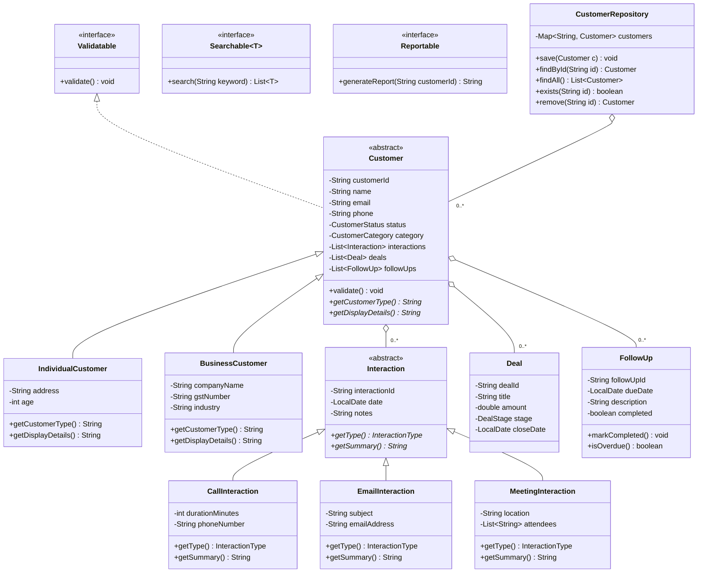

# CRM System (Console-Based, Core Java)
**Course:** Object Oriented Techniques using Java (CCSE0355) | Group 20  
**Project Type:** University Academic Project (Problem-Based Learning / Viva Demo)

A beginner-friendly, console-based Customer Relationship Management (CRM) system built using pure Core Java (JDK 17+). The project is specifically designed to illustrate fundamental Object-Oriented Programming (OOP) concepts such as **Abstraction**, **Inheritance**, **Polymorphism**, **Encapsulation**, **Interfaces**, **Checked Exception Handling**, and **File I/O Persistence** without any external libraries.

---

## What This Project Does

The CRM system helps small businesses and sales representatives manage their customer relationships through a clean terminal menu:
- **Customer Management**: Register individual consumers or business clients, view profiles, update contact info, and delete records.
- **Communication Logging**: Record phone calls, emails, and meetings under each customer's history.
- **Sales Deal Pipeline**: Track deals across lifecycle stages (`NEW`, `NEGOTIATION`, `WON`, `LOST`) and calculate revenue.
- **Follow-up Reminders**: Schedule follow-ups with due dates, view pending tasks sorted chronologically, and mark tasks completed.
- **File Persistence**: Save the entire database to a local text file (`data/crm_data.txt`) and reload it anytime.
- **Summary Analytics**: View 360-degree reports for individual customers as well as overall sales pipeline metrics.

---

## UML Class Diagram

The following diagram illustrates the relationships between the core classes and interfaces:



---

## Project Structure

The project strictly follows a **single-class / single-feature** per file design:

```text
CRM/
├── src/
│   └── com/crm/
│       ├── app/
│       │   ├── Main.java               # Application entry point
│       │   └── MenuHandler.java        # Menu orchestrator and user prompt flows
│       ├── exception/                  # Custom checked exceptions
│       │   ├── CustomerNotFoundException.java
│       │   ├── DuplicateCustomerException.java
│       │   ├── InvalidDealException.java
│       │   └── InvalidInputException.java
│       ├── interfaces/                 # Contract definitions
│       │   ├── Reportable.java
│       │   ├── Searchable.java
│       │   └── Validatable.java
│       ├── model/                      # Domain entities and enums
│       │   ├── Customer.java           # Abstract base customer
│       │   ├── IndividualCustomer.java # Individual consumer subclass
│       │   ├── BusinessCustomer.java   # B2B enterprise customer subclass
│       │   ├── Interaction.java        # Abstract base communication log
│       │   ├── CallInteraction.java    # Phone call subclass
│       │   ├── EmailInteraction.java   # Email message subclass
│       │   ├── MeetingInteraction.java # Meeting subclass
│       │   ├── Deal.java               # Sales opportunity
│       │   ├── FollowUp.java           # Reminder task
│       │   ├── CustomerCategory.java   # Enum: NEW, REGULAR, VIP, WHOLESALE
│       │   ├── CustomerStatus.java     # Enum: LEAD, PROSPECT, ACTIVE, INACTIVE
│       │   ├── DealStage.java          # Enum: NEW, NEGOTIATION, WON, LOST
│       │   └── InteractionType.java    # Enum: CALL, EMAIL, MEETING
│       ├── service/                    # Decoupled single-feature services
│       │   ├── CustomerRepository.java # In-memory store (HashMap)
│       │   ├── AddCustomerService.java
│       │   ├── ViewCustomerService.java
│       │   ├── SearchCustomerService.java
│       │   ├── UpdateCustomerService.java
│       │   ├── DeleteCustomerService.java
│       │   ├── LogInteractionService.java
│       │   ├── InteractionHistoryService.java
│       │   ├── TagCustomerService.java
│       │   ├── ScheduleFollowUpService.java
│       │   ├── PendingFollowUpService.java
│       │   ├── CompleteFollowUpService.java
│       │   ├── AddDealService.java
│       │   ├── UpdateDealStageService.java
│       │   ├── SummaryReportService.java
│       │   ├── FilePersistenceService.java
│       │   └── DataSeedService.java
│       ├── util/                       # Helper utilities
│       │   ├── ConsoleHelper.java      # Safe Scanner input wrapper
│       │   ├── IdGenerator.java        # Auto-incrementing zero-padded ID generator
│       │   └── InputValidator.java     # Email and phone validation rules
│       └── test/
│           └── CRMVerificationTest.java # Automated test suite for examiner verification
├── data/
│   └── crm_data.txt                    # Default saved data file
├── OOP_CONCEPTS.md                     # Table mapping OOP principles to files
├── VIVA_QA.md                          # 25 likely viva questions and answers
└── README.md                           # Project guide (this file)
```

---

## How to Compile and Run

### On Windows (PowerShell)
From the `CRM/` directory:

```powershell
# 1. Compile all Java sources into the out directory
javac -d out (Get-ChildItem -Recurse -Filter *.java src).FullName

# 2. Run the application
java -cp out com.crm.app.Main

# 3. (Optional) Run the automated test suite
java -cp out com.crm.test.CRMVerificationTest
```

### On Linux / macOS / Bash
From the `CRM/` directory:

```bash
# 1. Compile all Java sources
javac -d out $(find src -name "*.java")

# 2. Run the application
java -cp out com.crm.app.Main

# 3. (Optional) Run the automated test suite
java -cp out com.crm.test.CRMVerificationTest
```

---

## Step-by-Step Sample Walkthrough (For Viva Demo)

When demonstrating the project to an examiner, follow this 5-minute walkthrough:

1. **Start the application**: Run `java -cp out com.crm.app.Main`.
2. **Seed or Load Demo Data**:
   - Select **Option 17** (Load Demo Seed Data) and choose `2` (fresh demo records), OR
   - Select **Option 16** and press <kbd>Enter</kbd> to load `data/crm_data.txt`.
3. **View All Customers**:
   - Select **Option 2**, then choose `2`. You will see all loaded customers (`C001`, `C002`, `C003`, `C004`).
4. **Add a New Customer**:
   - Select **Option 1**. Choose `1` for Individual.
   - Enter name `Meera Patel`, email `meera@example.com`, phone `9876543210`, address `Pune`, age `26`.
   - The system registers her with auto-generated ID `C005`.
5. **Log an Interaction**:
   - Select **Option 6**. Enter Customer ID `C005`.
   - Choose `1` (Phone Call), duration `15` mins, phone `9876543210`, notes `Discussed product subscription`.
6. **Add a Deal**:
   - Select **Option 12**. Enter Customer ID `C005`.
   - Enter title `Annual Cloud License`, amount `35000`, close date `2026-11-01`.
7. **Schedule and Complete a Follow-Up**:
   - Select **Option 9**. Enter ID `C005`, due date `2026-10-15`, description `Send quote email`.
   - Select **Option 10** to view pending follow-ups.
   - Select **Option 11** to mark it completed using ID `C005` and the follow-up ID (e.g., `F006`).
8. **Generate Summary Report**:
   - Select **Option 14**, then choose `2` to view total customers, won revenue, and active pipeline value.
9. **Save and Exit**:
   - Select **Option 15** and press <kbd>Enter</kbd> to save to `data/crm_data.txt`.
   - Select **Option 0** to exit cleanly.

---

## Viva Study Resources
- [`OOP_CONCEPTS.md`](OOP_CONCEPTS.md): A concise reference table linking Abstraction, Inheritance, Polymorphism, Encapsulation, and Interfaces directly to our Java code.
- [`VIVA_QA.md`](VIVA_QA.md): 25 questions and 3-line answers covering every design decision and potential improvement.
